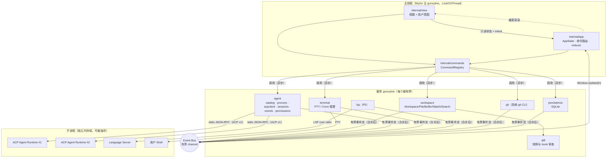
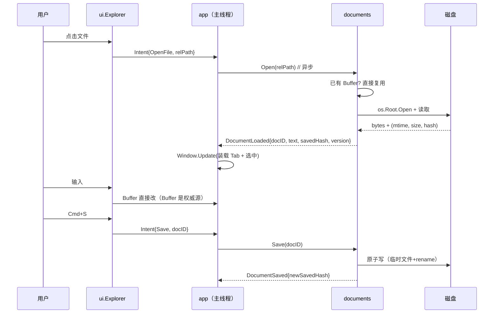
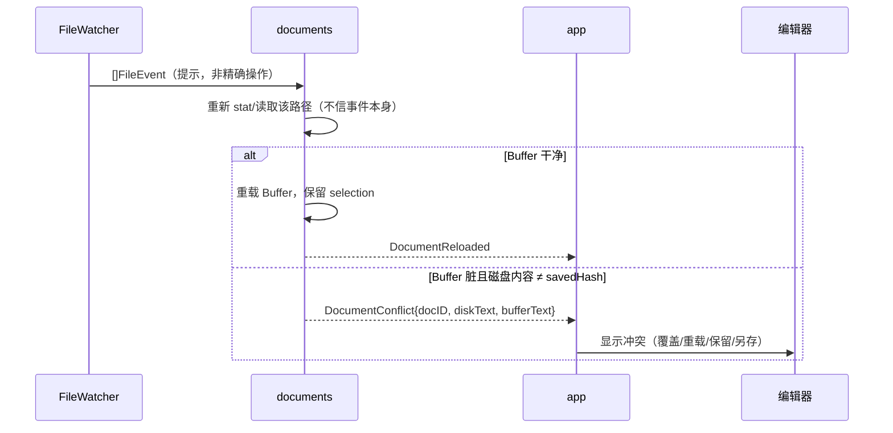
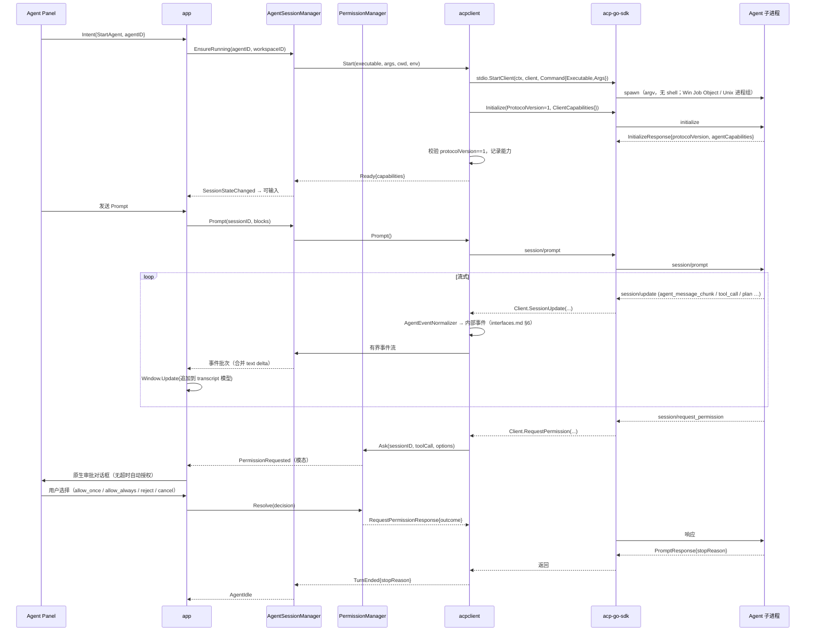
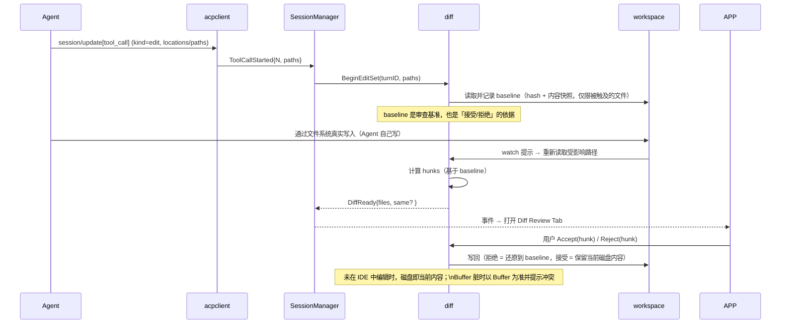

# 架构设计（architecture）

> 状态：**P1 已落地**（真实文件树 / 编辑器读写 / 冲突 / Diff 审查 / 原生终端），模块路径
> `github.com/QinYangWang/omo`。P1 起按本文实现。已核实的依赖事实见
> `docs/dependencies.md`，接口草案见 `docs/interfaces.md`，威胁模型见 `docs/security.md`，
> 实测数字见 `docs/benchmarks.md`。

## 1. 约束与设计原则

| # | 约束 | 落点 |
|---|---|---|
| C1 | 主应用是 Go，UI 必须原生（无 WebView/Electron/React/TS） | MyGo `ui`：自绘（Metal/D3D11/GL/CPU），`WindowOptions.Content` |
| C2 | 低内存、低空闲 CPU、快启动 | 单窗口、按需启动子进程、虚拟化列表、有界缓存、事件合并；无轮询 |
| C3 | Agent 是独立子进程，走 ACP；IDE 不依赖 Node | `stdio.StartClient` + 进程树清理；IDE 二进制不含 Node |
| C4 | ACP 是唯一协议边界，不耦合任何具体 Agent 内部 | `internal/agent/acpclient` 是唯一 import ACP SDK 的包 |
| C5 | 用稳定 ACP v1 | `acp.WireProtocolVersion = 1`（SDK 版本 v1.5.1，类型生成自 schema-v1.26.0） |
| C6 | 复用 MyGo 的 Editor/Terminal/Watch/SQLite | 见 dependencies.md §4 |
| C7 | `CGO_ENABLED=0` | 已实测 6 个平台通过 |
| C8 | 按需启动 | Agent 仅在用户点「启动」或发首条 prompt 时拉起；空闲回收可配 |
| C9 | 标准库优先 | 文件/进程/日志/Git 全部 stdlib |

设计原则：**一个写者**（UI 状态只允许主线程写）、**一个边界**（所有 ACP/SQLite/进程调用都在
服务层 goroutine 里）、**可替换**（每个第三方能力都藏在一个内部接口后面）。

## 2. 系统架构



关键点：

- **箭头方向单一**：服务层不认识 `ui`，只产生事件；UI 不启动进程、不碰 SQLite、不懂 ACP。
- **`Window.Update(fn)` 是唯一的跨线程状态写入口**（MyGo 文档明确：goroutine 通过它改 UI 状态）。
- 子进程各自独立内存域，IDE 内存与 Agent/LSP/Terminal 内存**分开计量**（见 §8）。

## 3. 模块职责与依赖规则

### 3.1 分层

```
internal/view          ← 只 import mygo/ui、internal/app 的状态类型、internal/commands、internal/i18n
internal/app           ← 应用状态、reducer、Workspace 生命周期、布局与偏好
internal/commands      ← 命令注册与派发（UI 与快捷键共用一条路径）
internal/workspace     ← 目录边界、文件读写、Buffer、watch、搜索
internal/documents     ← Buffer 权威来源与磁盘状态协调（与 workspace 同层，独立文件集）
internal/diff          ← 修改基准、hunk 审查、接受/拒绝/撤销
internal/agent/*       ← ACP 边界（唯一 import ACP SDK 的地方）
internal/terminal      ← PTY/Conn 生命周期与执行策略
internal/lsp           ← P5
internal/git           ← 系统 git CLI 封装
internal/persistence   ← SQLite schema/迁移/保留策略
internal/config        ← 配置模型与校验
```

依赖规则（CI 用 `go list -deps` 或 lint 断言）：

1. `internal/view` **禁止** import `acp-go-sdk`、`plugins/sqlite`、`os/exec`。
2. 服务包 **禁止** import `github.com/egoist/mygo/ui`（它们不能碰 UI 类型，也就在任何 goroutine 里都安全）。
3. 只有 `internal/agent/acpclient` 可以 import `github.com/caelis-labs/acp-go-sdk`；
   只有 `internal/persistence` 可以 import `plugins/sqlite`。
4. `internal/app` 只依赖**接口**（`docs/interfaces.md` 里的 `WorkspaceService` 等），便于注入 Fake。

### 3.2 为什么这样切

- UI 只做「把状态画出来 + 把意图变成 Command」，所以 UI 测试可以完全 headless
  （实测 `ui.NewTester(view, w, h)` 能渲染 Sidebar + Split + 编辑器并断言文本）。
- ACP 全部藏在 `acpclient` 后面，所以可以**不用子进程**测试整条链路
  （实测：`net.Pipe` 双端 + `acp.NewAgentSideConnection` 假 Agent，跑通
  initialize/newSession/prompt 流式/requestPermission）。
- `diff` 独立于 `agent`：Diff Review 既要服务 Agent 修改，也要服务 Git 变更，不能绑在 ACP 上。

## 4. 关键数据流

### 4.1 打开并编辑文件（含外部修改协调）



外部变化（编辑中文件被 Agent/Git 改动）：



Watcher 语义是**提示**（`mygo.FileEvent` 文档："treat them as hints to read the files again"），
所以永远重读 + 校验，不做「事件 → 一次操作」的映射。

### 4.2 ACP 主流程（含权限请求与取消）



取消：

```
用户 Cancel → SM.Cancel(sessionID)
  → SDK.Cancel(session/cancel 通知)
  → 同时本地把该 session 所有 pending RequestPermission 以 "Cancelled" 结束
    （ACP 规定：取消时必须对挂起的权限请求回 cancelled）
  → 事件流打上 turnID 过滤，丢弃取消后迟到的 update（保留原始事件到诊断环形缓冲）
```

### 4.3 Agent 改文件 → Diff 审查



要点：**baseline 只在被触及的路径上保存**（有界），不存整个 Workspace 快照；超过上限
（文件数/总字节）时降级为「只保留 hash + 提示重新读取」，必要时退回 Git 作为基准。

## 5. 生命周期

### 5.1 Workspace

```
Closed → Opening(规范化根 + ID + os.Root + watcher) → Open → Closing → Closed
                     ↘ Failed(path 非法/不可读)
```
- 一个进程内**同一时刻只 Open 一个 Workspace**（MVP）。多 Workspace 是 P6 的扩展点，不是第一版。
- 切换 Workspace = 关闭旧 watcher/Buffer/LSP/终端，再 Open 新的；Agent 进程按策略回收。
- `os.Root`（`os.OpenRoot`）随 Workspace 创建：所有文件访问都以它为根，符号链接不得指向根外
  （stdlib 明确保证），根跟随目录移动。

### 5.2 Agent 进程

```
Absent → Starting → Running → Stopping → Absent
             ↘ StartFailed(reason)
Running → Crashed(exit code, stderr tail) → Absent
```
- `Absent → Starting` 由显式命令或首条 prompt 触发；同一 agentID 只允许一个进程（互斥）。
- `Running` 内不重启：崩溃后连接一定失效，必须重建（见 5.3）。
- 停止顺序：`session/cancel`（尽力）→ 关闭 ACP 输入 → `Process.Shutdown(ctx)` 优雅等待
  → 超时后 `Process.Close()` 强杀整棵进程树。
- stderr：独立 goroutine 读取，环形缓冲保留尾部 N KB 用于诊断；不阻塞协议流。

### 5.3 ACP Connection 与 Session（**两个独立步骤**）

```
Connection: None → Dialing → Ready → (Degraded → Ready)* → Closed
Session:    None → Creating → Active → Idle → Active … → Detached/Closed
```

- 进程重启后旧 `Connection` 一律作废（`Closed`），**不能复用**。
- 新连接建立后：`initialize` → 若 Agent 声明 `agentCapabilities.loadSession`
  才尝试 `session/load(sessionID)`；不支持则 `Session → Detached`，UI 明示
  「当前 Agent 无法恢复上次会话，请新建」。绝不伪造「恢复成功」。
- `Connection.Degraded`：SDK 报告连接不可写（`Done()` 关闭前的错误/超时），UI 显示「已断开」，
  正在跑的任务标记为 `Unknown` 而不是 `Completed`。

### 5.4 Session 状态机（详细转移见 interfaces.md §5）

```
New → Initializing → Ready → Prompting → (Streaming) → Ready
                        ↓                    ↓
                     Cancelling ←────────────┘
                        ↓
                     Ready / Detached
任意状态 --连接丢失--> Disconnected --重建+load成功--> Initializing
任意状态 --用户关闭--> Closed
```

规则：
- 并发 Prompt：MVP **串行化**（同一 Session 同时只允许一个活跃 turn）；第二个请求排队或被拒绝，
  由 `SessionPolicy` 决定，默认「排队并在 UI 显示等待」。
- 权限等待：`Prompting` 期间的权限请求属于该 turn；`Cancelling` 时立即以 `cancelled` 结束。
- 重复事件：`AgentEventNormalizer` 按 `(sessionID, messageID, toolCallID)` 幂等合并，
  迟到事件只进诊断缓冲。

## 6. 线程模型（MyGo 官方契约）

已核实的 MyGo 规则（`docs/architecture.md` §Threading model）：

1. Go 主 goroutine 被 `runtime.LockOSThread` 绑到主线程，`App.Run()` 必须在主线程调用；
   所有平台回调、事件监听器都在主线程**同步**执行。
2. MyGo 所有公开方法**可以从任意 goroutine 调用**（内部 `postMain`/`onMain`/`await` 处理）。
3. `ui.Context`、`ui.Element` 是**单帧有效**的，禁止存进应用状态或跨 goroutine 传递；
   需要持久化的只有 `ui.Handle` 与 `ui.Services`（`Invalidate` 可从任意 goroutine 调用）。
4. 文件监听、终端读、ACP 读写各有自己的 goroutine。

本项目的落地规则：

| 数据 | 唯一写者 | 读 | 唤醒方式 |
|---|---|---|---|
| `AppState`（Tab、布局、Agent 面板模型） | 主线程 | UI 视图（主线程） | `win.Update(func(){...})` |
| `editor.Buffer` / `editor.State` | 主线程（编辑器输入）+ 主线程内应用（LSP 回填） | 视图 | `win.Invalidate()`（仅重绘） |
| Workspace/Agent/Persistence 服务内部状态 | 各自 goroutine + mutex | 事件 | 有界 channel |
| `terminal.Terminal` | 内部（有锁）；UI 只读 `Snapshot()` | 视图 | 终端自身触发 |

- 服务层**不得**持有 `*ui.Context` 或 `*ui.Element`；需要重绘时持 `ui.Services` 或 `*mygo.Window`。
- text delta 合并：ACP 单条 token 事件不逐条 `Update`，在服务侧合并到 ~16–33ms 一批后再提交，
  避免每 token 一帧（低 CPU 的关键）。
- UI 关闭/隐藏面板**不**取消后台任务；任务只由显式 Cancel、进程退出或 Workspace 关闭终止。

## 7. 目录结构（精简后）

```
omo/
├── main.go                 // 装配：app.New、开窗、Run（仅此而已）
├── go.mod  mygo.json       // mygo.json 含 i18n 目录（internal/i18n/locales）
├── resources/icon.png
├── scripts/bench/          // 启动/空闲/内存的采集脚本（bench.ps1、bench.sh）
├── .github/workflows/ci.yml
├── internal/
│   ├── app/                // ★P0 AppState、Intent、命令、bench 模式
│   ├── view/               // ★P1 视图：shell、sidebar、editor、agent panel、bottom panel、statusbar
│   ├── commands/           // ★P0 命令表（按钮/快捷键/菜单同一路径）
│   ├── i18n/               // ★P0 catalog + locales/{en,zh-Hans}.json
│   ├── workspace/          // ★P1 os.Root、读写、watcher、路径安全检查
│   ├── documents/          // ★P1 Buffer 权威源 + 原子保存 + 磁盘冲突
│   ├── diff/               // ★P1 HEAD/buffer 基准 + 应用审查结果
│   ├── agent/
│   │   ├── catalog/        // P2 AgentRegistry（定义、信任、启用）
│   │   ├── process/        // P2 AgentProcessManager（stdio、退出、stderr、清理）
│   │   ├── acpclient/      // P2 ★唯一 import ACP SDK 的包
│   │   ├── sessions/       // P2 AgentSessionManager + 状态机
│   │   ├── events/         // P2 AgentEventNormalizer + 诊断环形缓冲
│   │   └── permissions/    // P2 PermissionManager
│   ├── (terminal lives in internal/app) // ★P1 终端会话（PTY）
│   ├── git/                // ★P1 系统 git CLI：分支、改动列表、HEAD 文本
│   ├── config/             // P3 配置模型 + 校验
│   └── persistence/        // P3 SQLite schema/迁移/保留
├── docs/
└── testdata/
```

不做：`internal/lsp`（P5 前为空目录，不创建）、`internal/agent/mcp`（MVP 无）、
空包一律不建。`diff` 与 `documents` 保持独立包是因为 `diff` 同时服务 Git 与 Agent。

产品文案一律走 `internal/i18n`（en 为源语言，zh-Hans 译本在 `locales/zh-Hans.json`）；
代码注释与标识符用英文。视图通过 `ui.Context.Locale()` 取当前语言。

## 8. 内存与 CPU 预算（测量先行，不编数）

分成四本账，**分别测量**，因为子进程可以被独立杀死/回收：

| 账本 | 组成 | 控制手段 |
|---|---|---|
| IDE 核心 | Go 堆（Buffer、Tab、UI 状态）+ 窗口 surface | 虚拟化渲染、有界缓存、单窗口；空闲不轮询 |
| Agent 子进程 | 每个 Runtime 独立 | 按需启动、空闲回收、同时最多 1 个（MVP） |
| LSP 子进程 | 每语言一个 | 懒启动、按 Workspace 语言集合 |
| 终端/Shell | 每 Tab 一个 PTY | 上限可配（默认 4） |

硬性设计约束（不是目标数字）：
- transcript 只保留**窗口内可见 + 最近 N 条**，更早的滚动出内存（需要回看时从 Agent 或
  SQLite 摘要重建），不在 IDE 里保留完整对话。
- Diff 只对**被触及的文件**保存 baseline，且有总字节上限。
- 日志/诊断环形缓冲有字节上限；超出丢最旧。
- 大目录文件树：`ListState` 虚拟化 + 目录懒加载（展开才 readdir）。
- 编辑器本身按可视区域绘制（MyGo 提供），不整文件渲染。

**基线测量方法**（P1 就要建立，先量后优化）：
1. 冷启动 → 首个可用帧：从进程 start 到 window ready 的墙钟（3 次取中位）。
2. 空闲 60s：进程 CPU 时间增量（`time` / Windows `GetProcessTimes`），目标「无可测增长」。
3. 打开 1k / 10k / 50k 文件的 Workspace：RSS 与打开耗时。
4. 运行 1 个 Agent + 1 个终端 + 编辑器打开大文件：分别记录 IDE 与子进程 RSS。
5. 全部作为 `docs/architecture.md` 附录或 `docs/benchmarks.md`（P1 创建）的可复现脚本输出。

MyGo 自身给出的参考量级（**框架作者的测量，不是本项目的目标**）：原生 UI 窗口空闲约
44 MB（macOS 小窗口），counter 示例 65–67 MB（Linux，4K 半屏），空闲 CPU ≈0%，settled 窗口
不再请求帧、不装定时器。我们以此为**上界参考**，不据此承诺本项目数字。

## 9. ACP 兼容性风险（已实测）

`acp.Client.SessionUpdate` 是强类型联合。**未知的 `sessionUpdate` 变体会被 SDK 直接丢弃**：
实测假 Agent 发送 `{"sessionUpdate":"some_future_update_kind",...}` 后，客户端回调**未被调用**，
SDK 只记录 `level=WARN msg="notification handler failed" err="{...\"error\":\"no matching variant for union\"}"`，
连接**存活**、prompt 正常返回。

这违反「不得丢弃未知 ACP 内容」的要求，因此：

- **P2 采用**：`acp.ClientSideConnection`（类型安全、能力自动门禁：未实现的可选接口自动
  `method-not-found`，我们绝不会虚假声明 fs/terminal 能力）。
- **同时**：`AgentEventNormalizer` 保留 `SessionUpdate` 的 `_meta` 与已识别字段；
  未知变体丢失时记一条诊断（含 session id、turn id、时间），并在 UI 诊断面板可查。
- **逃生舱（ADR-0002 候选，P3 才评估）**：改用 `acp.NewConnectionWithOptions(handler, …)` +
  自写 `MethodHandler`（只需实现 `session/update`、`session/request_permission` 两个入站方法），
  出站用 `acp.SendRequest[T](conn, ctx, acp.AgentMethodSessionPrompt, params)`（SDK 已导出的泛型助手）。
  这样未知变体可以原样落盘/展示。**这是 `internal/agent/acpclient` 内部改动，UI 无感**——
  这也是「UI 不得依赖 SDK 类型」的直接收益。

## 10. 扩展点（不拖慢 MVP）

| 扩展 | 预留方式 | 何时做 |
|---|---|---|
| 多 Agent 并行 | `AgentSessionManager` 以 `(agentID, sessionID)` 为键；进程管理器已支持 N 进程 | P6 |
| Pi Durable Harness / 自定义 Agent | 只是 `AgentRegistry` 里的一条 `executable+args` 定义 | 无需改核心 |
| Skills / MCP | ACP `mcpServers` 字段已在 `NewSessionRequest`；`McpCapabilities` 已协商 | P6 |
| 多 Workspace / 远程 | `WorkspaceService` 接口 + 单实例假设收敛在 `app` | P6 |
| LSP 全量 | `LSPManager` 接口 + 编辑器三个回调钩子 | P5 |
| ACP v2 | 版本门禁在 `acpclient`（`protocolVersion != 1` 直接拒绝） | 协议稳定后 |
